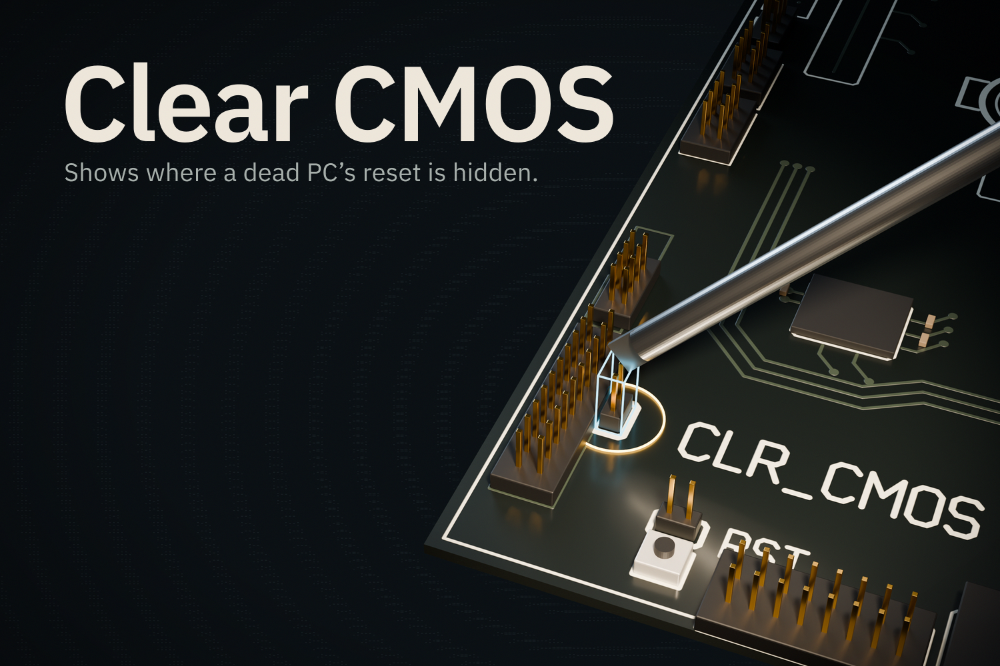

# Clear CMOS

> **About this repository:** This is a clean snapshot of the project's private development repository at commit `f3cf892`. Commit IDs quoted in these documents refer to that private history. Internal coordination logs and review notes are not included.

A Lens for Snap's SPECS glasses, made for Learn AR with SPECS on Devpost.

One BIOS change left a PC unable to boot. The fix took minutes, but there was no way to see where to go, and touching anything felt too risky, so the PC sat dead for months. That really happened to one of us.

Clear CMOS is the dead-PC reset I really had to do, rebuilt as a glasses guide that shows where the reset is hidden and warns you when your reach lingers in a no-go zone.

## Who it's for
New PC builders, and anyone looking at a dead machine who doesn't know which part is safe to touch.

## What it does
- **It starts from the symptom.** The DRAM light is on and the monitor says "No signal". The label reads "DRAM light stuck on? Pinch it." You pinch the light itself to confirm.
- **It shows what's covered.** After "Scan this PC (simulated)", an amber X-ray sweep shows the board through the parts on top, with a 3x callout beside the `CLR_CMOS` jumper.
- **It sets the order.** A safe-path ribbon runs from the power cord to the reset, clear of the red no-go boxes. From the cord step until it's unplugged, pinching anything else gets a refusal.
- **It warns before you grab.** If the pointer rests in a no-go box for 350 ms, the box flashes and a line says why (checked by LEAF with a scripted pointer). If you click anyway, the part shakes and refuses with its own line. Each warning or refusal line shows for 2.5 s. A part that is not the next step gets "Follow the green ring first." The memory gets "Try the BIOS reset first."
- **It catches the wrong pins.** The board has two pin pairs side by side, RST and `CLR_CMOS`. Pinch RST at the reset step and it shakes and says "RST restarts. Use CLR_CMOS." `CLR_CMOS` is the pair that does the reset.
- **It walks the fix.** Touch the two `CLR_CMOS` pins with a metal screwdriver (animated), wait (time-lapsed), rebuild, and power on. The DRAM light holds through first-boot memory training, then goes out.
- **It sounds each moment.** Eight short sounds: a confirm on most finished steps, a sweep and a draw for the scan, a warning tick when you rest in a no-go box, a thud on a refused grab, a contact tick when the screwdriver touches the pins, a ring at the boot, and a chime that plays once when the arrow to the power cord is out of view.

Clearing CMOS is a common first fix. It does not always work. If the DRAM light never goes out, the reset may not have worked. After a real reset, the board manual says to open BIOS Setup and load defaults (p.30, Load Optimized Defaults).

## What is simulated
- The PC is virtual, modeled on a Gigabyte B650 AORUS PRO AX with an RX 7900 XT.
- A button stands in for recognition: "Scan this PC (simulated)".
- The mouse stands in for your hand. The video caption says "Mouse = hand. Recognition simulated."
- Part positions are estimates read from the board manual's layout page (p.4). They aren't checked on a physical board, and placement in this build is illustrative.
- The recovery is simulated: the Lens ends on "Simulated recovery: POST successful."
- It runs in the Lens Studio preview only. Comfort and real hand tracking on SPECS glasses are unproven.
- This is guidance for one board, not a professional repair guide. Unplug the PC first and handle parts gently.

Guided AR repair already exists, for example Microsoft Dynamics 365 Guides and Dell AR Assistant. Other projects, including FieldFix AR, already have X-ray views and blocked steps. We don't claim those as new.

## How it was built
1. **Plan:** the Devpost Learn plan-lens skill interviewed us and wrote the design brief: `devpost/design-brief.md`. Research and iterations are in `devpost/research/`.
2. **Build:** CLAD (Snap's Lens Studio agent plugin) wrote the scripts and built the scene through the Lens Studio MCP. A reviewer agent scored build rounds 1 to 3, and we fixed its top flaw after rounds 1 and 2 (`devpost/build-log.md`).
3. **Test:** LEAF scenarios run the steps in the preview through Interaction Kit, with LEAF's scripted interactor in place of a person. At commit `517291d` (tag `leaf-freeze`), **10 of 10 scenarios passed** (`devpost/build-log.md`, Feature freeze), including the wrong-pins refusal and a scenario that checks each sound plays at its moment. Mutation checks showed the new assertions can fail: letting RST finish the fix, or removing a sound call, made a scenario fail. Not done yet: a manual walk-through, the 16:9 frame check, listening to the sounds, and testing on a device.
4. **Facts:** board positions are estimated from the exact board manual's layout drawing (`devpost/research/board-layout.md`); the RST pins beside `CLR_CMOS` were checked by eye. The board art, the sounds and the thumbnail were generated for this project (`art/`).

## Run it
1. Install Git LFS (`git lfs install`), then clone this repo with Git:
   `git clone https://github.com/KnigguKniggu-droid/clear-cmos`
   **Do not use Download ZIP.** It replaces meshes, sounds and packages with placeholder files.
2. Open `LearnWithARSPECShackathon.esproj` in Lens Studio 5.24.
   - Opening the project shows a "SPECS is in Preview Release" dialog. Click OK.
   - The initial compile of a fresh clone takes about 40 s, and Preview says "Preview is not ready" until it finishes (reported by William).
3. Use Interactive Preview. WASD moves, Q and E go down and up, right-drag looks around, and a click is a pinch.

## Board art

The board drawing is original artwork. Part positions are estimates based on the publicly available layout of a Gigabyte B650 AORUS PRO AX motherboard. No manufacturer images or manuals are included. Not affiliated with or endorsed by Gigabyte.

## Built with
Lens Studio, SPECS, the Devpost Learn plan-lens skill pack, CLAD, the Lens Studio MCP, Spectacles Interaction Kit, Spectacles UI Kit and Leaf.

Pre-existing: Snap's SPECS Base Template, the Bitmoji 3D package (a LEAF dependency), the plan-lens skill pack, CLAD, the Lens Studio MCP, Spectacles Interaction Kit, Spectacles UI Kit, Leaf, Icons and Motion packages. AI agents generated the scripts, meshes, sound effects, board art and thumbnail during the submission period. Gigabyte and AMD names describe the hardware.
